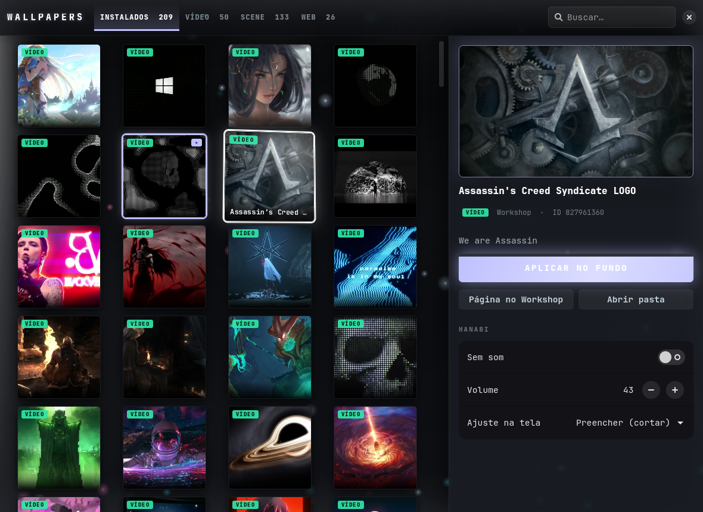
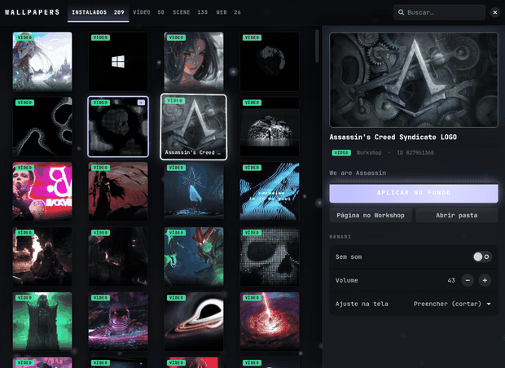

# Hanabi Wallpapers

A Wallpaper Engine–style library browser for GNOME. It reads every wallpaper you have installed or subscribed to in **Wallpaper Engine (Steam)** and applies the video ones as your live desktop background through the **[Hanabi](https://github.com/jeffshee/gnome-ext-hanabi)** GNOME extension.

> 🇧🇷 [Versão em português abaixo](#português)



<p align="center"></p>

## Features

- **Your whole library:** Workshop subscriptions, Wallpaper Engine's built-in wallpapers, your own projects, and presets (resolved to the wallpaper they depend on). Tabs filter by type (Video / Scene / Web), and there is a search box.
- **Click to apply:** clicking a video wallpaper sets it as Hanabi's background right away.
- **Live preview:** Scene and Web wallpapers can't be a background on GNOME (see below), so double-clicking them opens a live preview window through [linux-wallpaperengine](https://github.com/Almamu/linux-wallpaperengine). Presets open with their own colors and settings, and the app tells you when linux-wallpaperengine can't open a wallpaper.
- **Details panel:** an animated preview, tags, description, a link to the Workshop page, and Hanabi's mute, volume and screen-fit settings.
- **Effects:**
  - 3D card tilt that follows the mouse, with a light glare.
  - Video or GIF preview when you hover a card.
  - Floating particles over a blurred live backdrop of your current wallpaper.
  - A shockwave and spark burst when you click.
  - Cards enter in a staggered cascade, and the active wallpaper has a pulsing border.

## Requirements

- GNOME (tested on GNOME 51, Wayland)
- The [Hanabi](https://github.com/jeffshee/gnome-ext-hanabi) extension
- Python 3, PyGObject, pycairo, GTK ≥ 4.12, libadwaita ≥ 1.6, and GStreamer (`gst-libav` for mp4)
- Wallpaper Engine installed through Steam, in the default library folder `~/.steam/steam/steamapps`
- `ffmpeg`, for thumbnails
- Optional: `linux-wallpaperengine`, for the Scene/Web live preview

## Install

```sh
git clone https://github.com/TopDarkFlames/hanabi-wallpapers
cd hanabi-wallpapers
./install.sh
```

Then open **Hanabi Wallpapers** from your app menu, or run `~/.local/bin/hanabi-picker` (just `hanabi-picker` if `~/.local/bin` is in your `PATH`). To check your library without opening a window, run `hanabi-picker --list`.

## Known limitations

- **Web wallpapers in linux-wallpaperengine** crash at startup with `close symbol missing` ([Almamu/linux-wallpaperengine#628](https://github.com/Almamu/linux-wallpaperengine/issues/628)). The app applies the workaround from that issue automatically: it preloads `libcef.so`.
- **Some Scene wallpapers** don't open in linux-wallpaperengine, or open with parts missing, such as unsupported puppet models. That is a limitation of linux-wallpaperengine; the app shows a message when the preview fails.
- The preview window is a normal window, not the desktop background.

## Why only video wallpapers become the background

GNOME's compositor (Mutter) doesn't implement `wlr-layer-shell`, so `linux-wallpaperengine` can't place itself behind your windows on GNOME. Hanabi works around this from inside GNOME Shell, but it only plays video. Scene and Web wallpapers stay preview-only on GNOME. On KDE or wlroots compositors (Hyprland, Sway, …) you can use linux-wallpaperengine directly.

## Getting Hanabi running on GNOME 51 (`patches/`)

These are the fixes I needed on CachyOS / GNOME 51 (October 2026). They are workarounds for my setup, not official fixes.

| Patch | Problem | Fix |
|---|---|---|
| `aur-PKGBUILD-build-fix.patch` | The AUR package `gnome-shell-extension-hanabi-git` no longer builds (`_build/extension.js does not exist`), because Hanabi now uses TypeScript. | Runs `npm ci && npm run build` before meson, and adds GNOME 51 to `shell-version`. |
| `hanabi-gnome51-glsleffect-workaround.patch` | The extension shows in red, with `TypeError: class heritage (intermediate value).GLSLEffect is not an object or null`. GNOME 51 removed `Shell.GLSLEffect`. | Skips the rounded-corners effect when `Shell.GLSLEffect` doesn't exist. The video works, but the corners in the Overview stay square. This patch applies to the **built** `extension.js` that is installed. |
| `window-list-hide-hanabi-renderer.patch` | With the *Window List* extension, Hanabi's renderer windows (`@io.github.jeffshee.HanabiRenderer!{…}`) show up in the bottom bar. On Wayland they can't mark themselves `skip_taskbar`. | Makes Window List ignore windows with `HanabiRenderer` in their title, and re-check when a window's title changes. |

**Credit:** the proper GNOME 51 fix is [jeffshee/gnome-ext-hanabi#264](https://github.com/jeffshee/gnome-ext-hanabi/pull/264) by @SkySlider. It ports the effect to `Clutter.ShaderEffect` and keeps the rounded corners. Once it is merged, you won't need my GLSLEffect workaround. See also issue [#263](https://github.com/jeffshee/gnome-ext-hanabi/issues/263).

**PKGBUILD fix** (Arch / AUR):

```sh
paru -G gnome-shell-extension-hanabi-git   # or: git clone https://aur.archlinux.org/gnome-shell-extension-hanabi-git.git
cd gnome-shell-extension-hanabi-git
patch -p1 < /path/to/patches/aur-PKGBUILD-build-fix.patch
makepkg -si
```

If the AUR package has changed since this patch was made (October 2026), the patch may not apply. In that case, make the same two edits by hand: add `npm` to `makedepends`, and run `npm ci && npm run build` inside `gnome-ext-hanabi` before `arch-meson`.

**Extension patches:** they were made against Hanabi commit `c18dd76` and `gnome-shell-extensions` 51.0, so other versions may not apply. Apply them as root. Back up the files first, because a package update will overwrite them:

```sh
cd /usr/share/gnome-shell/extensions
sudo patch -p1 < /path/to/patches/hanabi-gnome51-glsleffect-workaround.patch
sudo patch -p1 < /path/to/patches/window-list-hide-hanabi-renderer.patch
```

Log out and back in afterwards, because GNOME Shell only reloads extension code at login.

## Credits

- [Hanabi](https://github.com/jeffshee/gnome-ext-hanabi) by Jeff Shee: this app only changes Hanabi's settings and contains none of its code.
- [linux-wallpaperengine](https://github.com/Almamu/linux-wallpaperengine) by Almamu, used for live previews.
- Wallpaper Engine and all Workshop content belong to their respective authors. This project ships no wallpapers.
- Built with help from Claude (Anthropic).

## License

GPL-3.0-or-later, the same license as Hanabi.

---

## Português

Um navegador de wallpapers no estilo do Wallpaper Engine para o GNOME. Ele lê todos os wallpapers que você tem instalados ou inscritos no **Wallpaper Engine (Steam)** e aplica os de vídeo como fundo animado usando a extensão **[Hanabi](https://github.com/jeffshee/gnome-ext-hanabi)**.

- **Biblioteca inteira:** inscrições do Workshop, wallpapers que já vêm com o Wallpaper Engine, seus próprios projetos e presets. Abas filtram por tipo (Vídeo / Scene / Web), e tem uma busca.
- **Clique para aplicar:** clicar num wallpaper de vídeo já aplica ele no fundo pelo Hanabi.
- **Preview ao vivo:** wallpapers Scene e Web não podem ir pro fundo no GNOME, porque o Mutter não tem `wlr-layer-shell`. Por isso eles abrem numa janela de preview ao vivo pelo `linux-wallpaperengine`.
- **Painel de detalhes:** preview animado, tags, descrição, link pra página do Workshop, e os controles do Hanabi: mudo, volume e ajuste na tela.
- **Efeitos:**
  - Cards que inclinam em 3D seguindo o mouse, com reflexo de luz.
  - Preview em vídeo ou GIF ao passar o mouse.
  - Partículas por cima do wallpaper atual desfocado ao fundo.
  - Onda de choque e faíscas ao clicar.
  - Cards que entram em cascata, e borda que pulsa no wallpaper ativo.

**Instalar:** `git clone` este repositório e rode `./install.sh`. Depois abra **Hanabi Wallpapers** no menu de aplicativos.

**Hanabi no GNOME 51:** a pasta `patches/` tem o que precisei pra fazer o Hanabi funcionar no GNOME 51:
- o PKGBUILD do AUR consertado;
- o contorno do `Shell.GLSLEffect`, que o GNOME 51 removeu;
- a correção das janelas do Hanabi aparecendo na barra da extensão Window List.

A correção definitiva do `GLSLEffect` é o PR [#264](https://github.com/jeffshee/gnome-ext-hanabi/pull/264) do @SkySlider. O meu patch é só um contorno até esse PR ser aceito.

**Licença:** GPL-3.0-or-later. Feito com ajuda do Claude (Anthropic).
